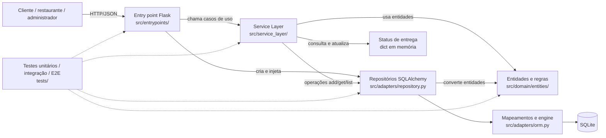

# Arquitetura e trade-offs

## 1. Escopo

O sistema oferece operações de delivery para clientes, restaurantes e administradores: cadastro e consulta de clientes e restaurantes, criação e consulta de pedidos, histórico por cliente e atualização do status de entrega. A API HTTP é a interface disponível no repositório; não há interface gráfica nem autenticação implementadas.

## 2. Requisitos arquiteturais

As prioridades abaixo são propostas para o escopo atual. As medidas são critérios verificáveis, não resultados de testes de carga.

| Prioridade | Atributo e cenário (fonte, estímulo, ambiente, artefato, resposta e medida) |
| --- | --- |
| 1 | **Integridade dos dados:** a fonte é um cliente; o estímulo é criar um pedido válido e consultá-lo; o ambiente é uma instância da aplicação conectada ao SQLite; os artefatos são o serviço de pedidos, o repositório e o mapeamento ORM; a resposta esperada é recuperar os mesmos itens, quantidades e total. **Medida:** 100% dos casos válidos de persistência e recuperação cobertos por testes de integração preservam os dados e o total. |
| 2 | **Testabilidade:** a fonte é um desenvolvedor; o estímulo é alterar uma regra de negócio; o ambiente é a execução local da suíte, sem servidor HTTP nem banco real; os artefatos são domínio e serviços; a resposta esperada é verificar a regra com repositórios substitutos e testes unitários. **Medida:** os testes unitários relevantes executam sem iniciar Flask nem conectar a um banco externo e passam na CI. |
| 3 | **Modificabilidade:** a fonte é um desenvolvedor; o estímulo é adicionar uma implementação de persistência; o ambiente é uma mudança restrita à infraestrutura; os artefatos são repositórios e ORM; a resposta esperada é suportar a implementação sem alterar regras do domínio. **Meta:** nenhuma entidade de `src/domain/` precisa ser alterada e as mudanças de persistência ficam em `src/adapters/`. O repositório ainda não tem uma segunda implementação concreta para confirmar essa meta. |

### Restrições e objetivos

- **Restrições:**
  - Stack tecnológica obrigatória definida pela disciplina: **Python 3**, **pytest**, **Flask** (ou FastAPI) e **SQLAlchemy** com **SQLite**.
  - Estrutura de pacotes seguindo a divisão arquitetural da Fase 1 (`src/domain/`, `src/service_layer/`, `src/adapters/` e `src/entrypoints/`), mantendo a suíte de testes existente verde na Integração Contínua (GitHub Actions em Python 3.12).
  - Regras de processo: histórico de commits preservado (sem rebase destrutivo ou force-push) e rastreabilidade por integrante.
- **Objetivos:** manter as regras de negócio e a orquestração de casos de uso testáveis fora dos frameworks, oferecer uma API HTTP REST simples com tratamento padronizado de erros e persistir os agregados sem acoplar as entidades às tabelas do SQLAlchemy.
- **Estado atual relevante:** `create_sqlite_engine()` usa SQLite em memória por padrão (`sqlite+pysqlite:///:memory:`); as entregas (`Entrega`) são mantidas em um dicionário em memória injetado nos serviços, e não em tabela SQLAlchemy.

## 3. Arquitetura atual

O código combina camadas, uma camada de serviços e repositórios que separam o modelo de domínio do ORM. Há uma inversão parcial de dependências: a API injeta repositórios nos serviços, mas o contrato `AbstractRepository` está declarado no módulo de adapters, e não junto ao domínio ou à camada de serviços.

| Componente | Localização | Responsabilidade |
| --- | --- | --- |
| Entry point | `src/entrypoints/flask_app.py` | Define rotas via `create_app()`, valida o formato básico do JSON (`_corpo_json`, `_texto`), injeta repositórios nos serviços, serializa respostas e traduz exceções (`NaoEncontrado` -> 404, `Conflito` -> 409, `ValueError` -> 400) em HTTP. |
| Service Layer | `src/service_layer/services.py` | Orquestra os 9 casos de uso, valida pré-condições de unicidade e existência e coordena entidades, repositórios (`AbstractRepository`) e o dicionário de entregas recebidos por parâmetro. |
| Domínio | `src/domain/entities/` e `src/domain/model.py` | Representa entidades (`Cliente`, `Restaurante`, `Pedido`, `Produto`, `Entrega`), objetos de valor imutáveis (`Endereco`, `ItemPedido`) e regras de negócio sem importar Flask ou SQLAlchemy. |
| Repositórios e ORM | `src/adapters/repository.py` e `src/adapters/orm.py` | Declaram `AbstractRepository` e `SQLAlchemyRepository`, convertem entre entidades e modelos ORM (`_to_model` / `_to_entity`) e gerenciam a persistência em SQLite. |
| Testes | `tests/unit/` e `tests/e2e/` (`tests/integration/` reservado na estrutura) | `tests/unit/` verifica entidades de domínio e serviços com `FakeRepository` em memória; `tests/e2e/` exercita os fluxos HTTP no Flask integrados aos repositórios SQLAlchemy e SQLite em memória. |

## 4. Trade-offs e riscos

| Atributo | Como a arquitetura contribui | Custo ou prejuízo |
| --- | --- | --- |
| Integridade dos dados | As conversões entre entidades e modelos ficam no adapter; os testes de integração exercitam persistência e recuperação. | O status de entrega não usa o repositório: é guardado em memória e se perde ao reiniciar o processo. O pedido e o status também não compartilham uma transação. |
| Testabilidade | Serviços recebem repositórios por parâmetro; os testes podem usar um repositório falso. As entidades não dependem dos frameworks. | Há mais indireção e código de conversão do que numa implementação direta. Os contratos e implementações concretas também estão juntos em `src/adapters/repository.py`, o que enfraquece a direção arquitetural desejada. |
| Modificabilidade | Um adapter traduz entre objetos do domínio e tabelas, evitando que o ORM faça parte das entidades. | Essa separação ainda não provou portabilidade: só há implementação SQLAlchemy. Além disso, `RestauranteRepository` persiste nome e ID, mas não a lista de produtos da entidade. |

Dois trade-offs centrais são **testabilidade versus simplicidade** (repositórios e mapeamentos acrescentam indireção, mas permitem testes sem banco) e **isolamento do domínio versus esforço de persistência** (o domínio não depende do ORM, mas cada adapter precisa manter conversões corretas). Um risco operacional é a diferença entre a persistência SQLite e o dicionário de entregas: uma reinicialização pode deixar pedidos sem status recuperável. O SQLite em memória configurado por padrão também não é persistência durável para uso real.

## 5. Alternativa comparada

Uma alternativa concreta seria **Flask com Transaction Script e acesso direto ao SQLAlchemy**: cada rota ou função de caso de uso executaria consultas e alterações diretamente nos modelos ORM, sem entidades de domínio independentes nem repositórios.

| Atributo | Arquitetura atual: camadas, domínio e repositórios | Alternativa: Transaction Script com ORM direto |
| --- | --- | --- |
| Integridade dos dados | Conversões e regras ficam separadas; testes de integração verificam os repositórios. O estado de entrega em memória continua sendo uma lacuna. | Menos conversões e caminho mais curto até o banco; transações podem ficar evidentes no script. Regras de persistência e de negócio misturadas tornam mais fácil criar comportamentos diferentes entre rotas. |
| Testabilidade | Serviços e entidades podem ser testados sem HTTP ou banco, usando repositórios substitutos. | Testes de unidade para regras de negócio exigem separar ou simular acesso ao ORM; testes de integração podem ser mais diretos. |
| Modificabilidade | Um novo adapter pode preservar as entidades e os serviços, embora isso ainda não tenha sido demonstrado por uma segunda implementação. | Menos arquivos e abstrações no início; mudanças no modelo ORM ou no banco tendem a alcançar os scripts de caso de uso. |

Para o domínio atual, manteríamos a arquitetura em camadas, pois as regras de pedido e as conversões já são testadas em pontos distintos. Não a trataríamos como ports and adapters completa: o contrato do repositório deveria ficar numa camada interna, e o status de entrega precisaria de persistência consistente antes de uso durável. Para um protótipo CRUD muito pequeno, a alternativa poderia reduzir custo inicial; neste sistema, o isolamento já existente traz benefício verificável para testes.

## 6. Evidências do repositório

- **Isolamento do ORM e custo de mapeamento (`bd56b97` e `ac665e3`):** `bd56b97` adicionou o mapeamento declarativo SQLAlchemy em `src/adapters/orm.py` (**61 linhas**) mantendo o ORM fora de `src/domain/`; `ac665e3` introduziu `src/adapters/repository.py` (**119 linhas**), onde a conversão manual `_to_model` / `_to_entity` de `Cliente`, `Restaurante` e `Pedido` ocupa 57 linhas em troca de manter as entidades puras.
- **Separação entre orquestração, HTTP e persistência (`9849b96`, `ab5eec4` e `e4ecb22`):** `9849b96` implementou os 9 casos de uso em `src/service_layer/services.py` (atualmente **117 linhas**) recebendo repositórios por parâmetro; `ab5eec4` adicionou a API Flask em `src/entrypoints/flask_app.py` (**136 linhas**) e os testes E2E sem precisar alterar nenhuma classe de `src/domain/`.
- **Economia e velocidade proporcionadas pelo `FakeRepository` nos testes (`tests/unit/test_services.py` vs `tests/e2e/test_api.py`):** em `tests/unit/test_services.py` (`linhas 5–15`), um `FakeRepository` de apenas **11 linhas** substitui toda a infraestrutura do SQLAlchemy para testar os 33 cenários da camada de serviço. Comparando os tempos de execução com `pytest -o addopts=`:
  - Suíte unitária (`tests/unit/`, **114 testes** de domínio e serviços com `FakeRepository`): executa em **~0,14 s** (~1,2 ms por teste).
  - Suíte E2E (`tests/e2e/test_api.py`, **34 testes** passando pelo Flask, `SQLAlchemyRepository` e SQLite em memória): executa em **~0,32 s** (~9,4 ms por teste, quase 8 vezes mais lento por teste que a suíte unitária).
  - Suíte completa atual do repositório (**148 testes** somados): executa em **~0,56 s** em Python 3.12.2 (`153 testes em 1,59 s` quando somados os 5 testes locais de integração de repositório validados em Python 3.14.4).
- **Evidência de lacuna de persistência em `Restaurante` e `Entrega`:** `src/adapters/orm.py` (`linhas 21–26`) e `RestauranteRepository` (`src/adapters/repository.py`, `linhas 83–91`) persistem apenas `id` e `nome`, descartando `Restaurante.produtos`; já o status de `Entrega` é mantido apenas no dicionário `entregas = {}` instanciado em `create_app()` (`src/entrypoints/flask_app.py`, `linha 32`).
- **ADRs registrados pelo grupo em `docs/adr/`:**
  - `docs/adr/0001-modelagem-dos-agregados-de-dominio.md` (Davi França): composição de `Cliente`/`Endereco` e `Pedido`/`ItemPedido` imutáveis no domínio (`6b53d71`, `d058f44`).
  - `docs/adr/0002-Regras-de-negocio.md` (Leandro Machado): validação estrita de tipos e invariantes nas entidades com `ValueError` (`cb7d31a`, `7875dc1`, `ca6d033`, `1213e36`).
  - `docs/adr/0003-camada-de-servico-e-entrypoint-flask.md` (Victor Antunes): isolamento da Service Layer com injeção explícita de repositórios, `FakeRepository` e tratamento de erros no entrypoint Flask (`9849b96`, `ab5eec4`, `e4ecb22`, `937bad5`).
- **Integração Contínua (`41cd01f`):** o workflow `.github/workflows/ci.yml` executa o `pytest` automaticamente em cada push e pull request na branch `main` usando Ubuntu e Python 3.12.