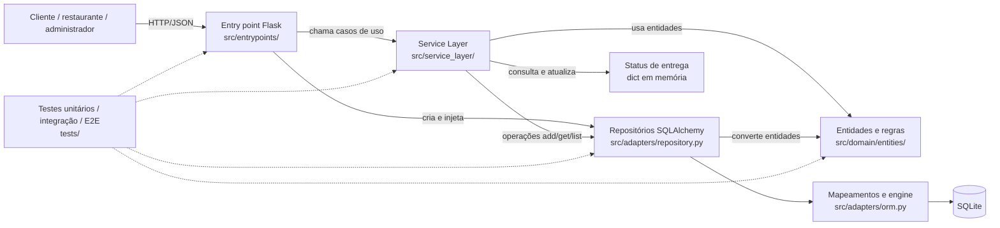

# Arquitetura e trade-offs

## 1. Escopo

O sistema oferece operações de delivery para clientes, restaurantes e administradores: cadastro e consulta de clientes e restaurantes, criação e consulta de pedidos, histórico por cliente e atualização do status de entrega. A API HTTP é a interface disponível no repositório; não há interface gráfica nem autenticação implementadas.

## 2. Requisitos arquiteturais

As prioridades abaixo são propostas para o escopo atual. As medidas são critérios verificáveis, não resultados de testes de carga.

| Prioridade | Atributo e cenário (fonte, estímulo, ambiente, artefato, resposta e medida) |
| --- | --- |
| 1 | **Integridade dos dados:** a fonte é um cliente; o estímulo é criar um pedido válido e consultá-lo; o ambiente é uma instância da aplicação conectada ao SQLite; os artefatos são o serviço de pedidos, o repositório e o mapeamento ORM; a resposta esperada é recuperar os mesmos itens, quantidades e total. **Medida:** 100% dos casos válidos de persistência e recuperação cobertos por testes de integração preservam os dados e o total. |
| 2 | **Testabilidade:** a fonte é um desenvolvedor; o estímulo é alterar uma regra de negócio; o ambiente é a execução local da suíte, sem servidor HTTP nem banco real; os artefatos são domínio e serviços; a resposta esperada é verificar a regra com repositórios substitutos e testes unitários. **Medida:** os testes unitários relevantes executam sem iniciar Flask nem conectar a um banco externo e passam na CI. |
| 3 | **Modificabilidade:** a fonte é um desenvolvedor; o estímulo é adicionar uma implementação de persistência; o ambiente é uma mudança restrita à infraestrutura; os artefatos são repositórios e ORM; a resposta esperada é suportar a implementação sem alterar regras do domínio. **Meta:** nenhuma entidade de `src/domain/` precisa ser alterada e as mudanças de persistência ficam em `src/adapters/`. O repositório ainda não tem uma segunda implementação concreta para confirmar essa meta. |

### Restrições e objetivos

- Objetivos: manter as regras de negócio testáveis fora dos frameworks, oferecer uma API HTTP simples e persistir os agregados sem acoplar as entidades às tabelas do SQLAlchemy.
- Estado atual relevante: `create_sqlite_engine()` usa SQLite em memória por padrão; as entregas são mantidas em um dicionário em memória.

## 3. Arquitetura atual

O código combina camadas, uma camada de serviços e repositórios que separam o modelo de domínio do ORM. Há uma inversão parcial de dependências: a API injeta repositórios nos serviços, mas o contrato `AbstractRepository` está declarado no módulo de adapters, e não junto ao domínio ou à camada de serviços.

| Componente | Localização | Responsabilidade |
| --- | --- | --- |
| Entry point | `src/entrypoints/flask_app.py` | Define rotas, valida o formato básico das requisições, serializa respostas e converte exceções em respostas HTTP. |
| Service Layer | `src/service_layer/services.py` | Orquestra casos de uso e validações de entrada, usando entidades e repositórios recebidos por parâmetro. |
| Domínio | `src/domain/entities/` e `src/domain/model.py` | Representa entidades, objetos de valor e regras de negócio sem importar Flask ou SQLAlchemy. |
| Repositórios e ORM | `src/adapters/repository.py` e `src/adapters/orm.py` | Convertem entre entidades e modelos SQLAlchemy e implementam operações de persistência. |
| Testes | `tests/unit/`, `tests/integration/` e `tests/e2e/` | Verificam regras isoladas, persistência SQLite e fluxos HTTP. |

## 4. Trade-offs e riscos

| Atributo | Como a arquitetura contribui | Custo ou prejuízo |
| --- | --- | --- |
| Integridade dos dados | As conversões entre entidades e modelos ficam no adapter; os testes de integração exercitam persistência e recuperação. | O status de entrega não usa o repositório: é guardado em memória e se perde ao reiniciar o processo. O pedido e o status também não compartilham uma transação. |
| Testabilidade | Serviços recebem repositórios por parâmetro; os testes podem usar um repositório falso. As entidades não dependem dos frameworks. | Há mais indireção e código de conversão do que numa implementação direta. Os contratos e implementações concretas também estão juntos em `src/adapters/repository.py`, o que enfraquece a direção arquitetural desejada. |
| Modificabilidade | Um adapter traduz entre objetos do domínio e tabelas, evitando que o ORM faça parte das entidades. | Essa separação ainda não provou portabilidade: só há implementação SQLAlchemy. Além disso, `RestauranteRepository` persiste nome e ID, mas não a lista de produtos da entidade. |

Dois trade-offs centrais são **testabilidade versus simplicidade** (repositórios e mapeamentos acrescentam indireção, mas permitem testes sem banco) e **isolamento do domínio versus esforço de persistência** (o domínio não depende do ORM, mas cada adapter precisa manter conversões corretas). Um risco operacional é a diferença entre a persistência SQLite e o dicionário de entregas: uma reinicialização pode deixar pedidos sem status recuperável. O SQLite em memória configurado por padrão também não é persistência durável para uso real.

## 5. Alternativa comparada

Uma alternativa concreta seria **Flask com Transaction Script e acesso direto ao SQLAlchemy**: cada rota ou função de caso de uso executaria consultas e alterações diretamente nos modelos ORM, sem entidades de domínio independentes nem repositórios.

| Atributo | Arquitetura atual: camadas, domínio e repositórios | Alternativa: Transaction Script com ORM direto |
| --- | --- | --- |
| Integridade dos dados | Conversões e regras ficam separadas; testes de integração verificam os repositórios. O estado de entrega em memória continua sendo uma lacuna. | Menos conversões e caminho mais curto até o banco; transações podem ficar evidentes no script. Regras de persistência e de negócio misturadas tornam mais fácil criar comportamentos diferentes entre rotas. |
| Testabilidade | Serviços e entidades podem ser testados sem HTTP ou banco, usando repositórios substitutos. | Testes de unidade para regras de negócio exigem separar ou simular acesso ao ORM; testes de integração podem ser mais diretos. |
| Modificabilidade | Um novo adapter pode preservar as entidades e os serviços, embora isso ainda não tenha sido demonstrado por uma segunda implementação. | Menos arquivos e abstrações no início; mudanças no modelo ORM ou no banco tendem a alcançar os scripts de caso de uso. |

Para o domínio atual, manteríamos a arquitetura em camadas, pois as regras de pedido e as conversões já são testadas em pontos distintos. Não a trataríamos como ports and adapters completa: o contrato do repositório deveria ficar numa camada interna, e o status de entrega precisaria de persistência consistente antes de uso durável. Para um protótipo CRUD muito pequeno, a alternativa poderia reduzir custo inicial; neste sistema, o isolamento já existente traz benefício verificável para testes.

## 6. Evidências do repositório

- `bd56b97` adicionou o mapeamento SQLAlchemy em `src/adapters/orm.py` (61 linhas) e a dependência, mantendo o ORM fora das entidades.
- `ac665e3` introduziu `src/adapters/repository.py` com 119 linhas, incluindo operações comuns e conversões específicas de cliente, pedido e restaurante.
- `9849b96` adicionou 56 linhas de serviços; `ab5eec4` adicionou a API Flask e testes E2E (143 inserções em três arquivos). Em conjunto, os commits mostram a separação entre orquestração, HTTP e persistência.
- `41cd01f` adicionou o workflow do GitHub Actions para executar pytest em push e pull request contra `main`, usando Python 3.12.
- A última execução remota consultada foi a [run 48 da CI](https://github.com/DaviEmmerick/delivery-system-software-project/actions/runs/36582866568), com conclusão `success` em 29/09/2026 no commit `6567ee0`. Ela antecede este checkpoint e não valida estas alterações.
- Na validação local deste checkpoint, `python -m pytest -o addopts= -q` concluiu com **153 testes aprovados em 1,59 s**, em Python 3.14.4. Isso verifica o ambiente local; não substitui a confirmação de uma execução verde da CI no Python 3.12.