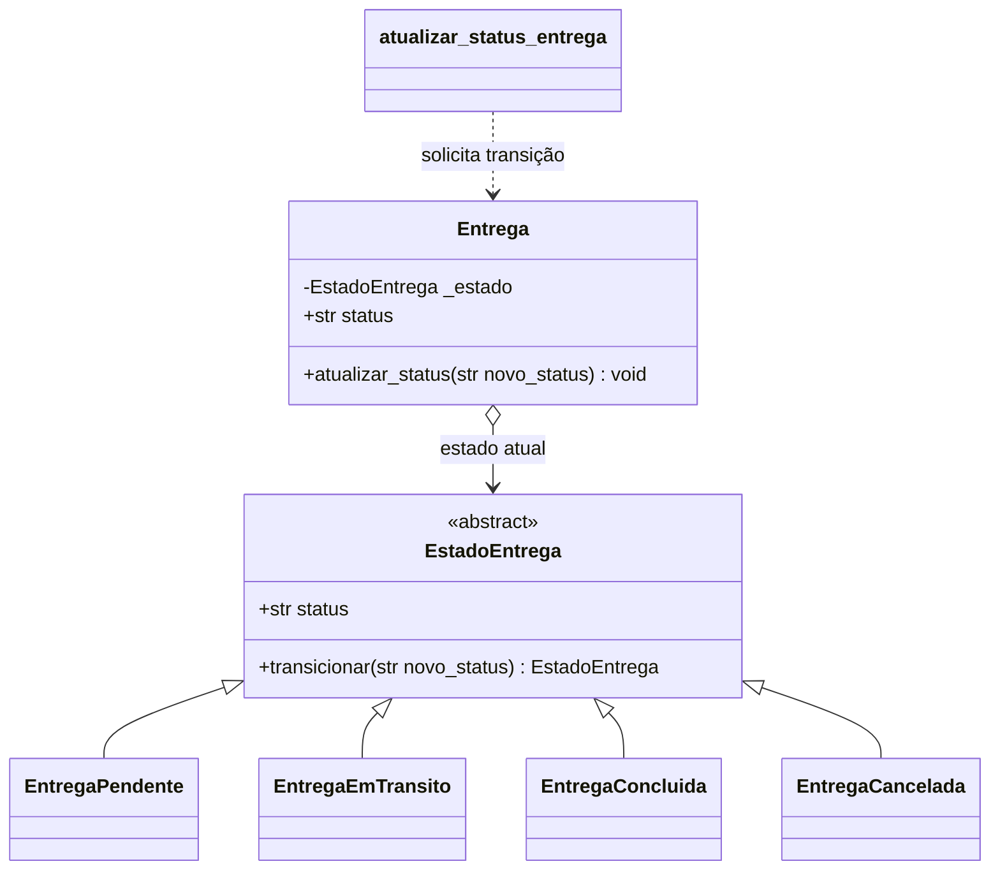

# Padrões GoF

## State no ciclo de vida de Entrega

**Categoria:** comportamental.

### Contexto e problema

Uma entrega percorre estados de negócio (`pendente`, `em_transito`, `entregue`
ou `cancelada`). Antes, o serviço aceitava qualquer status válido em qualquer
ordem e recriava a entidade para aplicar a mudança. Assim, era possível, por
exemplo, marcar uma entrega pendente como entregue diretamente ou reabrir uma
entrega já concluída.

O padrão State coloca a regra de transição no objeto `Entrega` e delega o
comportamento ao estado atual. As transições permitidas são:

- `pendente` -> `em_transito` ou `cancelada`;
- `em_transito` -> `entregue` ou `cancelada`;
- `entregue` e `cancelada` são estados finais;
- solicitar novamente o estado atual é uma operação idempotente.

O construtor aceita um status inicial válido para permitir reconstrução de uma
entrega já existente. Mudanças feitas durante o caso de uso passam por
`atualizar_status()` e respeitam as transições.

### Por que State

O ciclo de vida e as regras variam conforme o estado atual, que é justamente a
responsabilidade do State. A alternativa considerada foi manter condicionais
no serviço `atualizar_status_entrega`; isso manteria a regra fora da entidade,
concentraria os estados em um único método e exigiria alterá-lo sempre que um
estado ou transição fosse adicionado. A entidade agora protege sua própria
invariante, enquanto o serviço continua responsável pela busca e persistência.

### Participantes

- **Contexto:** `Entrega`, em `src/domain/entities/entrega.py`; mantém o estado
  atual, expõe `status` e delega `atualizar_status()`.
- **Estado abstrato:** `EstadoEntrega`; declara o contrato `transicionar()`.
- **Estados concretos:** `EntregaPendente`, `EntregaEmTransito`,
  `EntregaConcluida` e `EntregaCancelada`; cada um define as transições aceitas.
- **Cliente do contexto:** `atualizar_status_entrega()` em
  `src/service_layer/services.py`; valida a entrada, pede a transição à
  entidade e persiste o resultado.

### Diagrama de classes

### Testes

- `test_entrega_transita_de_pendente_para_em_transito_e_entregue` cobre o fluxo
  normal até a conclusão.
- `test_entrega_pendente_pode_ser_cancelada` cobre o cancelamento permitido.
- `test_entrega_estado_final_nao_permite_nova_transicao` garante que o estado
  final não seja alterado.
- `test_atualizar_status_entrega_rejeita_transicao_invalida` cobre a integração
  da regra com o serviço e confirma que uma tentativa inválida não muda o
  estado.
- `test_create_app_aceita_repositorio_de_entrega_injetado` percorre a API com a
  sequência de trânsito e conclusão.

### Custo

O padrão acrescenta uma classe abstrata e quatro classes concretas e mantém a
transição explícita entre estados. Há mais indireção do que uma string e uma
lista de valores, e novos estados exigem uma classe e a definição das
transições correspondentes. Em contrapartida, as regras ficam localizadas e
estados finais deixam de ser apenas convenções. A API preserva o formato da
requisição; transições inválidas continuam sendo reportadas como erro de
validação (`ValueError`, HTTP 400).