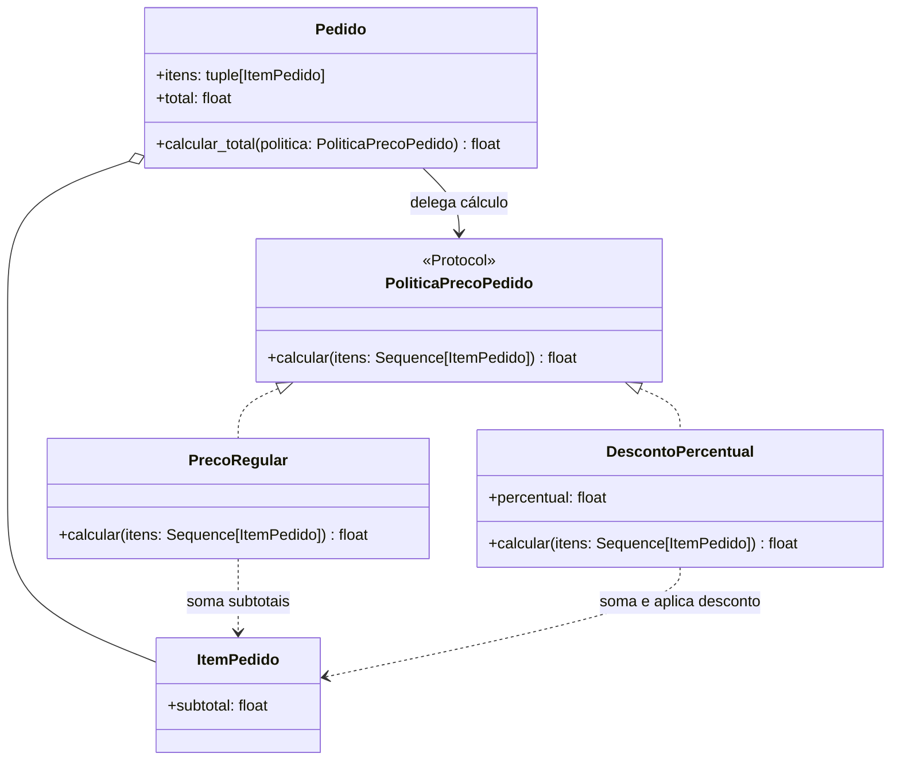

# Padrões GoF — checkpoint 3

## Davi França Emmerick de Souza — Strategy no agregado `Pedido`

### Contexto e problema

O total de um pedido hoje é a soma dos subtotais dos itens. Regras promocionais plausíveis, como aplicar um desconto percentual, mudam a forma de calcular o preço sem mudar os itens nem as invariantes do pedido. Colocar cada nova regra em condicionais dentro de `Pedido` faria o agregado crescer sempre que surgisse outra política.

### Padrão e alternativa

**Strategy (comportamental)** encapsula cada algoritmo de preço atrás do protocolo `PoliticaPrecoPedido`. `PrecoRegular` preserva o cálculo atual, enquanto `DescontoPercentual` exemplifica uma regra alternativa. O método `Pedido.calcular_total()` recebe a estratégia, permitindo variar o cálculo sem alterar a entidade. A propriedade `Pedido.total` continua usando `PrecoRegular`, preservando o comportamento das rotas, dos repositórios e dos chamadores existentes.

Uma alternativa seria adicionar condições ou um campo de desconto diretamente a `Pedido`; isso mistura configuração promocional com as invariantes do agregado e exige novas alterações para cada regra. Não foi introduzido um framework nem uma estratégia promocional padrão no serviço.

### Participantes

- **Contexto:** `Pedido`, que delega o cálculo a uma política fornecida.
- **Strategy:** `PoliticaPrecoPedido`, protocolo com a operação `calcular(itens)`.
- **Concrete Strategies:** `PrecoRegular` e `DescontoPercentual`.
- **Dados de cálculo:** `ItemPedido`, usado pelas estratégias para obter os subtotais.

### Testes e comportamento preservado

`tests/unit/test_pedido.py` verifica o cálculo regular, o cálculo com desconto, a rejeição de percentuais fora do intervalo de 0 a 100 (incluindo valores não finitos e booleanos) e que calcular uma promoção não altera o total regular do pedido. O total padrão continua sem arredondamento monetário adicional, como antes.

### Custo

A aplicação adiciona um protocolo e duas estratégias, além de uma operação de cálculo no agregado. Esse pequeno custo permite adicionar ou substituir algoritmos sem modificar as regras de composição dos itens. As estratégias são aplicadas sob demanda e não ficam armazenadas no pedido; logo, o valor persistido e exposto por `Pedido.total` permanece o total regular. Persistir campanhas ou registrar o valor efetivamente cobrado exigiria um requisito e um modelo de persistência próprios.
