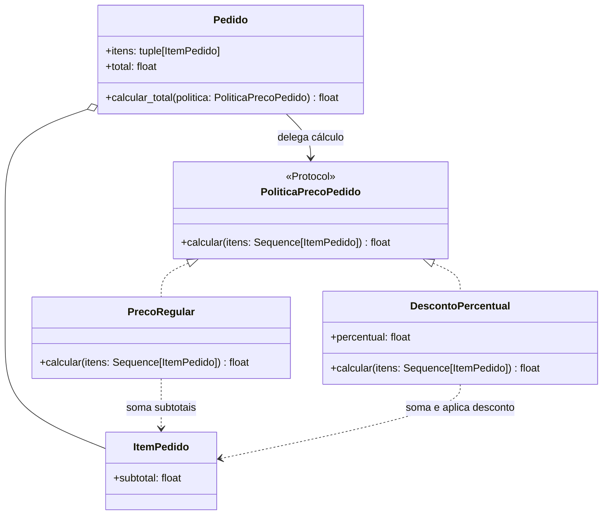
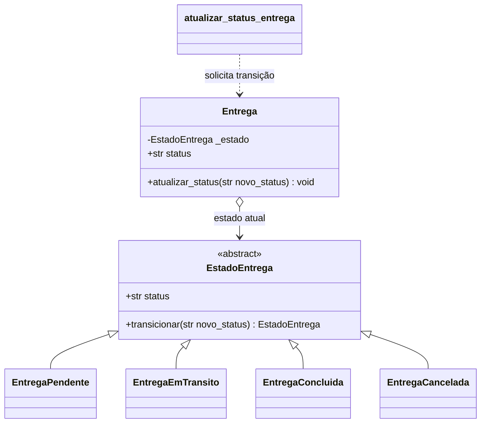
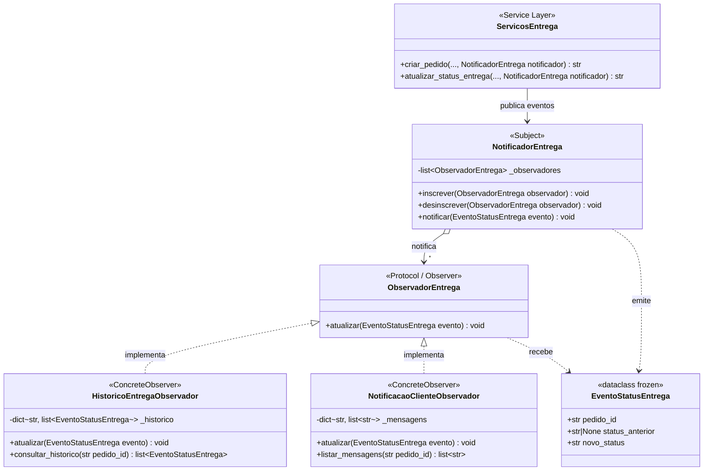
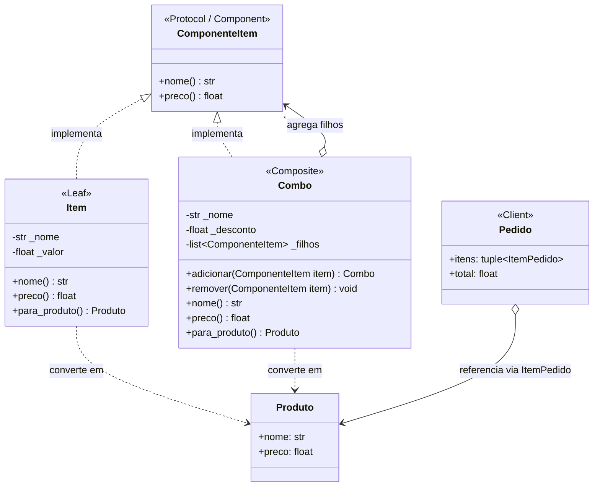

# Padrões GoF — checkpoint 3

## Davi França Emmerick de Souza — Strategy no agregado `Pedido`

### Contexto e problema

O total de um pedido hoje é a soma dos subtotais dos itens. Regras promocionais plausíveis, como aplicar um desconto percentual, mudam a forma de calcular o preço sem mudar os itens nem as invariantes do pedido. Colocar cada nova regra em condicionais dentro de `Pedido` faria o agregado crescer sempre que surgisse outra política.

### Padrão e alternativa

**Strategy (comportamental)** encapsula cada algoritmo de preço atrás do protocolo `PoliticaPrecoPedido`. `PrecoRegular` preserva o cálculo atual, enquanto `DescontoPercentual` exemplifica uma regra alternativa. O método `Pedido.calcular_total()` recebe a estratégia, permitindo variar o cálculo sem alterar a entidade. A propriedade `Pedido.total` continua usando `PrecoRegular`, preservando o comportamento das rotas, dos repositórios e dos chamadores existentes.

Uma alternativa seria adicionar condições ou um campo de desconto diretamente a `Pedido`; isso mistura configuração promocional com as invariantes do agregado e exige novas alterações para cada regra. Não foi introduzido um framework nem uma estratégia promocional padrão no serviço.

### Participantes

- **Contexto:** `Pedido`, que delega o cálculo a uma política fornecida.
- **Strategy:** `PoliticaPrecoPedido`, protocolo com a operação `calcular(itens)`.
- **Concrete Strategies:** `PrecoRegular` e `DescontoPercentual`.
- **Dados de cálculo:** `ItemPedido`, usado pelas estratégias para obter os subtotais.

### Testes e comportamento preservado

`tests/unit/test_pedido.py` verifica o cálculo regular, o cálculo com desconto, a rejeição de percentuais fora do intervalo de 0 a 100 (incluindo valores não finitos e booleanos) e que calcular uma promoção não altera o total regular do pedido. O total padrão continua sem arredondamento monetário adicional, como antes.

### Custo

A aplicação adiciona um protocolo e duas estratégias, além de uma operação de cálculo no agregado. Esse pequeno custo permite adicionar ou substituir algoritmos sem modificar as regras de composição dos itens. As estratégias são aplicadas sob demanda e não ficam armazenadas no pedido; logo, o valor persistido e exposto por `Pedido.total` permanece o total regular. Persistir campanhas ou registrar o valor efetivamente cobrado exigiria um requisito e um modelo de persistência próprios.

## State no ciclo de vida de Entrega

**Categoria:** comportamental.

### Contexto e problema

Uma entrega percorre estados de negócio (`pendente`, `em_transito`, `entregue`
ou `cancelada`). Antes, o serviço aceitava qualquer status válido em qualquer
ordem e recriava a entidade para aplicar a mudança. Assim, era possível, por
exemplo, marcar uma entrega pendente como entregue diretamente ou reabrir uma
entrega já concluída.

O padrão State coloca a regra de transição no objeto `Entrega` e delega o
comportamento ao estado atual. As transições permitidas são:

- `pendente` -> `em_transito` ou `cancelada`;
- `em_transito` -> `entregue` ou `cancelada`;
- `entregue` e `cancelada` são estados finais;
- solicitar novamente o estado atual é uma operação idempotente.

O construtor aceita um status inicial válido para permitir reconstrução de uma
entrega já existente. Mudanças feitas durante o caso de uso passam por
`atualizar_status()` e respeitam as transições.

### Por que State

O ciclo de vida e as regras variam conforme o estado atual, que é justamente a
responsabilidade do State. A alternativa considerada foi manter condicionais
no serviço `atualizar_status_entrega`; isso manteria a regra fora da entidade,
concentraria os estados em um único método e exigiria alterá-lo sempre que um
estado ou transição fosse adicionado. A entidade agora protege sua própria
invariante, enquanto o serviço continua responsável pela busca e persistência.

### Participantes

- **Contexto:** `Entrega`, em `src/domain/entities/entrega.py`; mantém o estado
  atual, expõe `status` e delega `atualizar_status()`.
- **Estado abstrato:** `EstadoEntrega`; declara o contrato `transicionar()`.
- **Estados concretos:** `EntregaPendente`, `EntregaEmTransito`,
  `EntregaConcluida` e `EntregaCancelada`; cada um define as transições aceitas.
- **Cliente do contexto:** `atualizar_status_entrega()` em
  `src/service_layer/services.py`; valida a entrada, pede a transição à
  entidade e persiste o resultado.

### Diagrama de classes

### Testes

- `test_entrega_transita_de_pendente_para_em_transito_e_entregue` cobre o fluxo
  normal até a conclusão.
- `test_entrega_pendente_pode_ser_cancelada` cobre o cancelamento permitido.
- `test_entrega_estado_final_nao_permite_nova_transicao` garante que o estado
  final não seja alterado.
- `test_atualizar_status_entrega_rejeita_transicao_invalida` cobre a integração
  da regra com o serviço e confirma que uma tentativa inválida não muda o
  estado.
- `test_create_app_aceita_repositorio_de_entrega_injetado` percorre a API com a
  sequência de trânsito e conclusão.

### Custo

O padrão acrescenta uma classe abstrata e quatro classes concretas e mantém a
transição explícita entre estados. Há mais indireção do que uma string e uma
lista de valores, e novos estados exigem uma classe e a definição das
transições correspondentes. Em contrapartida, as regras ficam localizadas e
estados finais deixam de ser apenas convenções. A API preserva o formato da
requisição; transições inválidas continuam sendo reportadas como erro de
validação (`ValueError`, HTTP 400).

---

## Observer no acompanhamento de eventos de entrega (Victor Antunes dos Santos)

**Categoria:** comportamental.

### Contexto e problema

No fluxo de pedidos e entregas da camada de serviço (`src/service_layer/services.py`), a entidade `Entrega` mantém apenas o seu estado atual (`pendente`, `em_transito`, `entregue` ou `cancelada`), substituindo-o no `EntregaMemoryRepository` a cada transição. Quando um pedido é criado (`criar_pedido`) ou tem seu status atualizado (`atualizar_status_entrega`), diferentes partes do sistema precisam reagir a essas mudanças — como registrar a **trilha de histórico/auditoria** de todas as transições pelas quais o pedido passou (`status_anterior` -> `novo_status`) e emitir **mensagens de notificação ao cliente**.

Sem um padrão dedicado, as funções `criar_pedido` e `atualizar_status_entrega` precisariam conhecer e chamar diretamente cada consumidor concreto (histórico, notificação, métricas), misturando responsabilidades de orquestração com efeitos colaterais e exigindo modificar os casos de uso sempre que uma nova reação a mudanças de entrega fosse adicionada.

### Por que Observer (e alternativa considerada)

O padrão **Observer** define uma dependência um-para-muitos entre um sujeito (`NotificadorEntrega`) e múltiplos observadores (`ObservadorEntrega`), de modo que, quando um evento de entrega ocorre (`EventoStatusEntrega`), todos os observadores inscritos são notificados automaticamente sem que a camada de serviço conheça suas classes concretas.

- **Alternativa considerada:** chamar diretamente objetos `HistoricoEntrega` e `ServicoNotificacao` dentro do corpo de `criar_pedido` e `atualizar_status_entrega` (ou adicionar listas fixas de callbacks procedurais em `EntregaMemoryRepository`). Essa alternativa foi descartada porque acoplaria os casos de uso às implementações concretas de auditoria e notificação, violando o Princípio Aberto/Fechado (OCP) quando novos consumidores precisassem observar o ciclo de entrega e dificultando ativar ou desativar observadores dinamicamente nos testes e na API (`create_app`).

### Participantes

- **Subject (Sujeito):** `NotificadorEntrega` (em `src/service_layer/services.py`) — mantém a coleção de observadores (`inscrever()`, `desinscrever()`) e dispara `notificar(evento: EventoStatusEntrega)`.
- **Observer (Interface do Observador):** `ObservadorEntrega` (em `src/service_layer/services.py`) — `Protocol` que define o contrato `atualizar(evento: EventoStatusEntrega) -> None`.
- **ConcreteObserver 1:** `HistoricoEntregaObservador` (em `src/service_layer/services.py`) — armazena em ordem cronológica os objetos imutáveis `EventoStatusEntrega` por `pedido_id` e expõe `consultar_historico(pedido_id)`, também conectado ao endpoint `GET /pedidos/<pedido_id>/entrega/historico` em `src/entrypoints/flask_app.py`.
- **ConcreteObserver 2:** `NotificacaoClienteObservador` (em `src/service_layer/services.py`) — formata e registra mensagens textuais de acompanhamento para o cliente a cada transição de status (`listar_mensagens(pedido_id)`).
- **Objeto de Evento / Clientes do Subject:** `EventoStatusEntrega` (dataclass imutável com `pedido_id`, `status_anterior` e `novo_status`), emitido por `criar_pedido()` e `atualizar_status_entrega()` em `src/service_layer/services.py` apenas quando uma transição válida e efetiva ocorre.

### Diagrama de classes

### Testes

- `test_observer_notifica_multiplos_observadores_no_ciclo_de_entrega` (`tests/unit/test_services.py`): inscreve `HistoricoEntregaObservador` e `NotificacaoClienteObservador` no `NotificadorEntrega`, executa a criação do pedido e as transições `pendente -> em_transito -> entregue` e verifica que ambos os observadores receberam os 3 eventos em ordem.
- `test_observer_desinscrito_ou_transicao_invalida_nao_recebe_eventos` (`tests/unit/test_services.py`): comprova que transições inválidas (barradas pelo State de `Entrega`) e atualizações idempotentes (mesmo status) não disparam notificações espúrias, e que `desinscrever()` interrompe o envio de eventos ao observador removido sem afetar os demais.
- `test_consultar_historico_entrega_via_observer` (`tests/e2e/test_api.py`): exercita o padrão de ponta a ponta na API Flask verificando a trilha de auditoria em `GET /pedidos/<pedido_id>/entrega/historico`.

### Custo

A introdução do padrão acrescenta um protocolo (`ObservadorEntrega`), uma classe de evento (`EventoStatusEntrega`), o sujeito (`NotificadorEntrega`), dois observadores concretos e um parâmetro opcional `notificador` nos serviços `criar_pedido` e `atualizar_status_entrega`. Isso adiciona uma camada de indireção no fluxo de atualização de entregas e exige cuidado para que observadores lentos ou com falha não bloqueiem o caso de uso síncrono. Em compensação, preserva a simplicidade de `Entrega` (que guarda apenas o estado corrente), permite consultar todo o histórico de transições na API e possibilita acoplar novos consumidores de eventos sem modificar a lógica de orquestração dos serviços.

---

## Composite na modelagem de itens e combos de produtos (João Gabriel de Azevedo)

**Categoria:** Estrutural.

### Contexto e problema

No domínio de delivery de alimentos, produtos frequentemente não são apenas itens simples e atômicos (como um hambúrguer avulso ou um refrigerante), mas sim **combos promocionais** ou **refeições completas** compostas por múltiplos itens (ex.: "Combo Casal" contendo hambúrgueres, batata frita e um "Combo Bebidas" com seus próprios sucos). Além disso, cada combo pode aplicar um percentual de desconto comercial específico sobre o somatório de seus componentes diretos.

Sem o padrão Composite, a modelagem de cardápio exigiria estruturas de dados ad-hoc (como listas heterogêneas de dicionários ou classes com condicionais `if item.is_combo: ... else: ...`), forçando o cliente (`Pedido` ou funções de cálculo) a inspecionar o tipo de cada elemento para somar seus valores recursivamente. Isso geraria acoplamento rígido, código procedural de travessia e violaria o Princípio Aberto/Fechado (OCP), tornando a adição de novos tipos de agrupamentos ou kits mais custosa e propensa a erros.

### Por que Composite (e alternativa considerada)

O padrão **Composite** permite compor objetos em estruturas em árvore para representar hierarquias parte-todo, possibilitando que o cliente trate objetos individuais (`Item`) e composições de objetos (`Combo`) de maneira completamente uniforme através de uma interface comum (`ComponenteItem`).

- **Interface uniforme:** Tanto uma folha (`Item`) quanto um nó composto (`Combo`) respondem aos métodos `nome()` e `preco()`.
- **Recursividade transparente:** Ao solicitar `preco()` de um `Combo`, este delega a chamada recursivamente para cada um de seus filhos (`ComponenteItem`), soma os resultados e aplica a taxa de desconto configurada. Os valores sobem pela árvore de nós de forma natural.
- **Alternativa considerada:** Modelar combos como listas planas associadas a flags de desconto em dicionários no `Produto`, ou uma cadeia de verificações (`Chain of Responsibility` / validações de regras procedurais). Essa abordagem exigiria lógica procedural com `isinstance`, loops aninhados para cada nível de kit e múltiplos pontos de modificação sempre que a composição de ofertas mudasse. O Composite elimina essas verificações eliminando qualquer condicional no cliente.

### Participantes

- **Component:** `ComponenteItem` (em `src/domain/entities/combo.py`) — `Protocol` com `@runtime_checkable` que declara o contrato comum para elementos da árvore: `nome() -> str` e `preco() -> float`.
- **Leaf (Folha):** `Item` (em `src/domain/entities/combo.py`) — representa o item atômico de venda (sem filhos). Mantém nome e valor monetário direto, implementando `nome()` e `preco()`, além do método utilitário de conversão `para_produto() -> Produto`.
- **Composite:** `Combo` (em `src/domain/entities/combo.py`) — mantém uma coleção de filhos `ComponenteItem` e um percentual de desconto decimal. Implementa `adicionar()`, `remover()`, e a operação `preco()`, que delega o cálculo a cada filho (`sum(f.preco() for f in self._filhos) * (1.0 - self._desconto)`). Também provê `para_produto()` para integração com entidades pré-existentes.
- **Client:** `Pedido` (ou rotas/casos de uso) que consome elementos `ComponenteItem` tratando itens simples e combos indistintamente, somando preços sem condicionais de tipo.

### Diagrama de classes

### Testes

A suíte `tests/unit/test_composite.py` cobre exaustivamente o padrão através de testes automatizados:
- `test_item_protocol_compliance_e_propriedades`: valida que `Item` cumpre o protocolo `ComponenteItem`, expõe `nome()`, `preco()`, igualdade por valor e formatação textual.
- `test_item_converte_para_produto`: valida que `Item.para_produto()` gera um `Produto` íntegro compatível com o domínio.
- `test_item_rejeita_nome_invalido` e `test_item_rejeita_valor_invalido`: validam invariantes de nome e valores negativos/tipos espúrios.
- `test_combo_criacao_e_manipulacao_de_filhos`: valida criação, fluent interface (`adicionar`), cálculo com desconto aplicado e remoção de filhos.
- `test_combo_rejeita_nome_invalido`, `test_combo_rejeita_desconto_invalido` e `test_combo_rejeita_adicao_de_objeto_incompativel`: garantem robustez e encapsulamento na montagem da composição.
- `test_cenario_slides_seminario_composite_arvore_de_precos`: reproduz integralmente a árvore de cálculo apresentada nos slides do seminário (Combo Bebidas R$ 16,00, Combo Casal com 10% de desconto R$ 70,20 e Sobremesa avulsa R$ 10,00), comprovando que tanto a soma direta via interface uniforme `sum(item.preco() for item in itens)` quanto a passagem para o agregado `Pedido` resultam exatamente no valor previsto de **R$ 80,20**.

### Custo

A aplicação do Composite adiciona um protocolo (`ComponenteItem`), uma classe folha (`Item`) e a classe composta (`Combo`), além de métodos de conversão para harmonizar com a entidade `Produto` já existente no sistema. O custo de manter classes separadas para folha e composto é largamente compensado pela simplicidade do cliente, que nunca precisa checar tipos nem conhecer a profundidade da árvore. O cálculo recursivo é O(N) em relação ao número total de nós da árvore, sendo eficiente para montagens usuais de cardápios de delivery.
