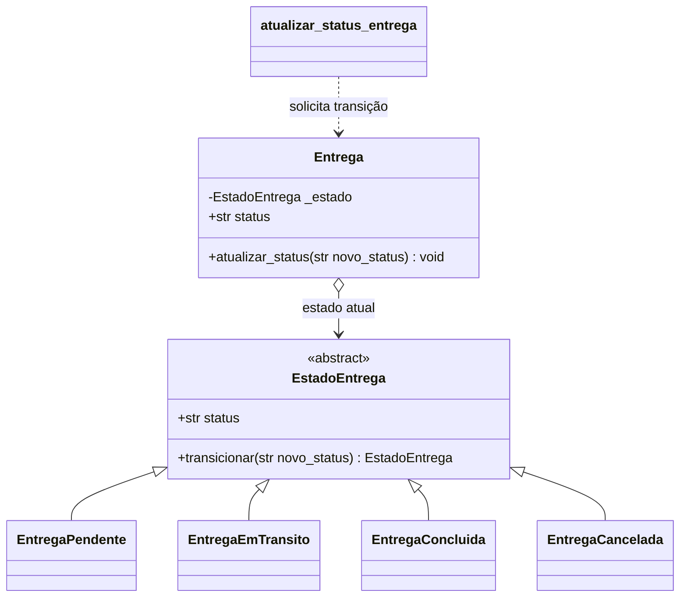
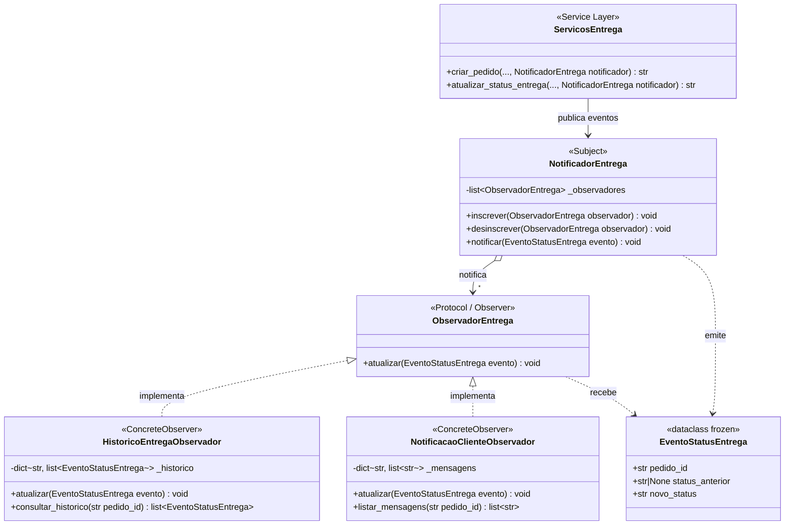

# Padrões GoF

## State no ciclo de vida de Entrega

**Categoria:** comportamental.

### Contexto e problema

Uma entrega percorre estados de negócio (`pendente`, `em_transito`, `entregue`
ou `cancelada`). Antes, o serviço aceitava qualquer status válido em qualquer
ordem e recriava a entidade para aplicar a mudança. Assim, era possível, por
exemplo, marcar uma entrega pendente como entregue diretamente ou reabrir uma
entrega já concluída.

O padrão State coloca a regra de transição no objeto `Entrega` e delega o
comportamento ao estado atual. As transições permitidas são:

- `pendente` -> `em_transito` ou `cancelada`;
- `em_transito` -> `entregue` ou `cancelada`;
- `entregue` e `cancelada` são estados finais;
- solicitar novamente o estado atual é uma operação idempotente.

O construtor aceita um status inicial válido para permitir reconstrução de uma
entrega já existente. Mudanças feitas durante o caso de uso passam por
`atualizar_status()` e respeitam as transições.

### Por que State

O ciclo de vida e as regras variam conforme o estado atual, que é justamente a
responsabilidade do State. A alternativa considerada foi manter condicionais
no serviço `atualizar_status_entrega`; isso manteria a regra fora da entidade,
concentraria os estados em um único método e exigiria alterá-lo sempre que um
estado ou transição fosse adicionado. A entidade agora protege sua própria
invariante, enquanto o serviço continua responsável pela busca e persistência.

### Participantes

- **Contexto:** `Entrega`, em `src/domain/entities/entrega.py`; mantém o estado
  atual, expõe `status` e delega `atualizar_status()`.
- **Estado abstrato:** `EstadoEntrega`; declara o contrato `transicionar()`.
- **Estados concretos:** `EntregaPendente`, `EntregaEmTransito`,
  `EntregaConcluida` e `EntregaCancelada`; cada um define as transições aceitas.
- **Cliente do contexto:** `atualizar_status_entrega()` em
  `src/service_layer/services.py`; valida a entrada, pede a transição à
  entidade e persiste o resultado.

### Diagrama de classes

### Testes

- `test_entrega_transita_de_pendente_para_em_transito_e_entregue` cobre o fluxo
  normal até a conclusão.
- `test_entrega_pendente_pode_ser_cancelada` cobre o cancelamento permitido.
- `test_entrega_estado_final_nao_permite_nova_transicao` garante que o estado
  final não seja alterado.
- `test_atualizar_status_entrega_rejeita_transicao_invalida` cobre a integração
  da regra com o serviço e confirma que uma tentativa inválida não muda o
  estado.
- `test_create_app_aceita_repositorio_de_entrega_injetado` percorre a API com a
  sequência de trânsito e conclusão.

### Custo

O padrão acrescenta uma classe abstrata e quatro classes concretas e mantém a
transição explícita entre estados. Há mais indireção do que uma string e uma
lista de valores, e novos estados exigem uma classe e a definição das
transições correspondentes. Em contrapartida, as regras ficam localizadas e
estados finais deixam de ser apenas convenções. A API preserva o formato da
requisição; transições inválidas continuam sendo reportadas como erro de
validação (`ValueError`, HTTP 400).

---

## Observer no acompanhamento de eventos de entrega (Victor Antunes dos Santos)

**Categoria:** comportamental.

### Contexto e problema

No fluxo de pedidos e entregas da camada de serviço (`src/service_layer/services.py`), a entidade `Entrega` mantém apenas o seu estado atual (`pendente`, `em_transito`, `entregue` ou `cancelada`), substituindo-o no `EntregaMemoryRepository` a cada transição. Quando um pedido é criado (`criar_pedido`) ou tem seu status atualizado (`atualizar_status_entrega`), diferentes partes do sistema precisam reagir a essas mudanças — como registrar a **trilha de histórico/auditoria** de todas as transições pelas quais o pedido passou (`status_anterior` -> `novo_status`) e emitir **mensagens de notificação ao cliente**.

Sem um padrão dedicado, as funções `criar_pedido` e `atualizar_status_entrega` precisariam conhecer e chamar diretamente cada consumidor concreto (histórico, notificação, métricas), misturando responsabilidades de orquestração com efeitos colaterais e exigindo modificar os casos de uso sempre que uma nova reação a mudanças de entrega fosse adicionada.

### Por que Observer (e alternativa considerada)

O padrão **Observer** define uma dependência um-para-muitos entre um sujeito (`NotificadorEntrega`) e múltiplos observadores (`ObservadorEntrega`), de modo que, quando um evento de entrega ocorre (`EventoStatusEntrega`), todos os observadores inscritos são notificados automaticamente sem que a camada de serviço conheça suas classes concretas.

- **Alternativa considerada:** chamar diretamente objetos `HistoricoEntrega` e `ServicoNotificacao` dentro do corpo de `criar_pedido` e `atualizar_status_entrega` (ou adicionar listas fixas de callbacks procedurais em `EntregaMemoryRepository`). Essa alternativa foi descartada porque acoplaria os casos de uso às implementações concretas de auditoria e notificação, violando o Princípio Aberto/Fechado (OCP) quando novos consumidores precisassem observar o ciclo de entrega e dificultando ativar ou desativar observadores dinamicamente nos testes e na API (`create_app`).

### Participantes

- **Subject (Sujeito):** `NotificadorEntrega` (em `src/service_layer/services.py`) — mantém a coleção de observadores (`inscrever()`, `desinscrever()`) e dispara `notificar(evento: EventoStatusEntrega)`.
- **Observer (Interface do Observador):** `ObservadorEntrega` (em `src/service_layer/services.py`) — `Protocol` que define o contrato `atualizar(evento: EventoStatusEntrega) -> None`.
- **ConcreteObserver 1:** `HistoricoEntregaObservador` (em `src/service_layer/services.py`) — armazena em ordem cronológica os objetos imutáveis `EventoStatusEntrega` por `pedido_id` e expõe `consultar_historico(pedido_id)`, também conectado ao endpoint `GET /pedidos/<pedido_id>/entrega/historico` em `src/entrypoints/flask_app.py`.
- **ConcreteObserver 2:** `NotificacaoClienteObservador` (em `src/service_layer/services.py`) — formata e registra mensagens textuais de acompanhamento para o cliente a cada transição de status (`listar_mensagens(pedido_id)`).
- **Objeto de Evento / Clientes do Subject:** `EventoStatusEntrega` (dataclass imutável com `pedido_id`, `status_anterior` e `novo_status`), emitido por `criar_pedido()` e `atualizar_status_entrega()` em `src/service_layer/services.py` apenas quando uma transição válida e efetiva ocorre.

### Diagrama de classes

### Testes

- `test_observer_notifica_multiplos_observadores_no_ciclo_de_entrega` (`tests/unit/test_services.py`): inscreve `HistoricoEntregaObservador` e `NotificacaoClienteObservador` no `NotificadorEntrega`, executa a criação do pedido e as transições `pendente -> em_transito -> entregue` e verifica que ambos os observadores receberam os 3 eventos em ordem.
- `test_observer_desinscrito_ou_transicao_invalida_nao_recebe_eventos` (`tests/unit/test_services.py`): comprova que transições inválidas (barradas pelo State de `Entrega`) e atualizações idempotentes (mesmo status) não disparam notificações espúrias, e que `desinscrever()` interrompe o envio de eventos ao observador removido sem afetar os demais.
- `test_consultar_historico_entrega_via_observer` (`tests/e2e/test_api.py`): exercita o padrão de ponta a ponta na API Flask verificando a trilha de auditoria em `GET /pedidos/<pedido_id>/entrega/historico`.

### Custo

A introdução do padrão acrescenta um protocolo (`ObservadorEntrega`), uma classe de evento (`EventoStatusEntrega`), o sujeito (`NotificadorEntrega`), dois observadores concretos e um parâmetro opcional `notificador` nos serviços `criar_pedido` e `atualizar_status_entrega`. Isso adiciona uma camada de indireção no fluxo de atualização de entregas e exige cuidado para que observadores lentos ou com falha não bloqueiem o caso de uso síncrono. Em compensação, preserva a simplicidade de `Entrega` (que guarda apenas o estado corrente), permite consultar todo o histórico de transições na API e possibilita acoplar novos consumidores de eventos sem modificar a lógica de orquestração dos serviços.
